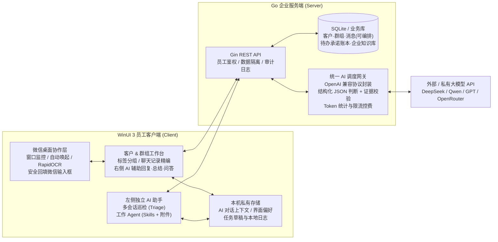

# 智美员工工作台 — AI 辅助客服与产品演进规划（参考 zhixian-wechat）

> **文档说明**：本文档在深度调研开源项目 **[DiscoveryH2/zhixian-wechat（知弦 PC v1.9.0）](https://github.com/DiscoveryH2/zhixian-wechat)** 架构与源码的基础上，结合我方 **WinUI 3 客户端 + Go 服务端** 的企业级多员工架构与合规要求，重新规划后续开发蓝图与实施路线。原初期计划文档保留在 [项目实施计划.md](项目实施计划.md) 作为历史基线。

---

## 1. 开源项目 `zhixian-wechat`（知弦 v1.9.0）深度拆解

`zhixian-wechat` 是一个面向 PC 端的微信客户沟通辅助工作台（Python + PySide6 + QtWebEngine + RapidOCR），其演进路线与我方“AI 辅助客服 + 微信桌面协作”的核心业务高度契合。

### 1.1 核心功能模块拆解

| 模块 | 知弦实现方式与亮点 | 关键源码参考 |
| --- | --- | --- |
| **模型接入与路由** | 支持任意 **OpenAI 兼容接口**（DeepSeek / 通义千问 / GPT / OpenRouter 等），仅填 `Base URL + API Key + Model` 即可驱动全链路；内置 `chat_json` 结构化判断适配器（将多维决策问题转成严格 JSON 输出，温度 `0`）。 | `src/core/client.py` |
| **结构化对话判断 + 候选回复** | 并非简单“自由问答”，而是先做 **7 维结构化判断**（字面/潜台词、真实意图、核心需求、危险/冲突等级 `0~9`、是否适合实质回应、最佳动作、紧张是否解除），并行生成 **3 条真人微信口语化候选回复**，再由模型排序标出推荐项；严格约束不堆砌模板套话、不编造未核实事实。 | `src/core/engine.py` `src/core/questions.py` `src/core/draft.py` |
| **客户洞察与证据强校验** | 结合统计数据与分层抽样对话生成最多 5 条洞察结论；**代码层强制校验**每条结论的 `evidence` 必须逐字命中原始消息文本与真实消息 ID，未命中直接拒绝，从工程上遏制大模型幻觉。 | `src/core/relationships.py` |
| **承诺 / 跟进待办闭环** | 自动扫描近期对话中的「客户未解决诉求」与「我方已答应的承诺」，同样要求逐字原文证据与时间短语引用；经人工审阅确认后保存为本机行动项（支持到期时间、完成、取消、重开）。 | `src/core/followups.py` `src/desk/actions.py` |
| **双形态 Agent（会话巡检 + 工作 Agent）** | 1. **会话巡检（Triage）**：一次选定多个会话，按固定不可篡改的工具链（`读历史 → 风险与下一步判断 → 条件性起草 → 证据卡片`）输出 `立即回复 / 需跟进 / 等待 / 无需动作 / 人工复核` 建议。 2. **工作 Agent**：独立多轮任务对话，可上传 PDF/Office/CSV/文本/图片，仅开放受限工具（`list_materials / search_materials / read_material / write_artifact`），**严禁执行终端命令或私自发微信**。 | `src/core/agent.py` `src/core/work_agent.py` |
| **背景与知识笔记** | 支持联系人备注、关系标签与知识笔记（带常驻背景开关）；在系统提示词中严格将聊天正文标记为**不可信数据（防 Prompt 注入）**，防止客户发来诱导话术劫持 AI。 | `src/core/questions.py` `src/desk/store.py` |
| **安全回填与受限自动回复** | 1. **安全填入（半自动）**：核验微信窗口、会话标题唯一匹配且输入框为空后填入草稿，由人工点发送。 2. **受限自动回复（可选）**：默认每次启动关闭；仅对白名单私聊及群内 `@我` 生效；内置防抖、冷却、每小时/每日限额、敏感信息拦截（禁止链接/手机号/银行卡/密码/超 180 字）、发送前双重 OCR 核验与失败自动清空草稿机制。 | `src/app/fill.py` `src/app/auto_send.py` `src/desk/auto_reply.py` |
| **数据获取与扩展功能** | 支持窗口 OCR、ChatLab 导出导入、WeFlow API 以及借助外部 CipherTalk 配置只读 SQLCipher 微信加密库；另有个人向的「朋友圈建议」与「数字分身」。 | `src/desk/wechat_db_source.py` `src/core/moments.py` |

### 1.2 面向我方企业场景的吸收与取舍策略

| 能力类别 | 决策 | 原因与落地方案 |
| --- | :---: | --- |
| **结构化对话分析 + 3 条候选回复 + 风险预警** | **核心吸收** | 直击一线客服痛点：快速读懂客户意图与投诉/流失风险，一键拿到自然可发的高质量话术。 |
| **统一 OpenAI 兼容网关（集中到 Go 服务端）** | **企业化升级** | 知弦是个人单机填 Key；我方改为 **Go 服务端统一配置 API 地址、密钥与模型路由**，员工端免配置且不接触真实密钥，便于公司控费与审计。 |
| **原文证据强校验 + 承诺/待办行动账本** | **核心吸收** | 销售与客服最怕“遗漏承诺”与“AI 乱编报价”，代码层原文逐字校验 + 人工确认入账是高价值护城河。 |
| **公司共享知识库 + 客户备注融合上下文** | **企业化升级** | 将知弦的个人笔记升级为「公司统一 FAQ / 产品话术 / 红线规则库 + 单客户员工备注」，AI 回复严格遵循公司口径。 |
| **双层 AI 体系（右侧轻量辅助 + 左侧全局 Agent）** | **核心吸收** | 与我方规划完全吻合：右侧聚焦单客户总结/辅助回复/问答；左侧独立「AI 助手」承载多会话巡检与带 Skills/附件的工作 Agent。 |
| **安全回填微信输入框（人工确认发送）** | **核心吸收** | 借鉴 `fill.py` + `auto_send.py` 的标题 OCR 核验与空框校验，实现「一键填入微信输入框，员工确认后按回车」，兼顾效率与零误发。 |
| **白名单受限自动回复** | **远期可选** | 作为 Phase D 高级开关预留，默认关闭，严格复刻 `AutoReplyGuard` 的白名单、限额、敏感拦截与双重核验安全阀。 |
| **本地 SQLCipher 微信加密库读取 / CipherTalk** | **明确不采用** | CipherTalk 依赖进程内存取钥且协议为 `CC BY-NC-SA 4.0`（禁止商用），存在合规与封号风险。我方坚持 **100% 合规桌面协作路线**（窗口监控 + 自动唤起 + 离线 RapidOCR 批量采集 + 人工核验）。 |
| **数字分身（纪念/陪伴）/ 朋友圈模拟** | **明确不纳入** | 偏个人社交/情感场景，与企业客服主航道无关，不分散研发精力。 |

---

## 2. 我方项目当前已达成基线盘点

经过前期迭代，我方客户端（WinUI 3 / .NET 10）与服务端（Go / Gin / SQLite）已经具备非常扎实的业务与桌面自动化底座：

### 2.1 已完成能力
- **账号认证与数据隔离**：强制登录门禁、员工 Token 会话、按 `owner_id` 严格数据隔离（预留接入甲方「智美员工Bot」认证器）。
- **客户档案管理（`CustomersPage`）**：
  - 左侧按微信标签自动分类、折叠/展开（状态持久化记忆、无跳动动画）+ 紧凑批量删除；
  - 统一 `+` 弹窗支持 **「截图识别 / 手动新建」** 与 **「微信通讯录管理按标签批量导入」**（自动去重、头像裁剪、保留员工备注）；
  - 右侧三选项卡骨架（`基本资料 / AI 总结 / AI 对话`）+ 弹窗分页编辑基本资料与员工备注；
  - 本地按客户隔离的 AI 工作区存储（`LocalAiWorkspaceStore`，上下文仅存本机）。
- **聊天记录采集与精细维护**：
  - 统一 **「导入对话」** 双模式弹窗：**单张聊天截图气泡识别** + **微信「查找聊天内容」自动搜索（微信号→备注→昵称自动回退）、按目标条数翻屏 OCR 批量采集**（自动清理表情与裁剪乱码、连续 3 次无新内容自动停）；
  - 聊天记录气泡支持右键 **「编辑消息 / 在上方插入 / 在下方插入 / 复制 / 多选 / 删除」**。
- **群组档案与群聊管理（`GroupsPage`）**：群信息截图建群、成员清单维护、群聊记录导入与气泡右键管理。
- **微信程序监控中心（`WeChatOcrPage`）**：2 秒无闪烁实时心跳监听、进程明细（PID / 版本 / 内存 / 线程 / 运行时长 / 路径）、窗口列表与 OCR 状态诊断、一键启动/唤起/重启微信、批量导入与诊断前自动从托盘/最小化唤起微信。
- **工作台体验**：`1440×900` 比例布局、明亮/黑夜模式 + 5 套柔和浅色配色、模块化使用介绍、本地日志排查面板。

### 2.2 进入 AI 阶段前需同步补齐的底座缺口
1. **聊天消息服务端 CRUD 补齐**：当前 Go 服务端仅有 `GET/POST /customers/:id/messages`（以及群消息），客户端气泡的**编辑、删除、上下方插入顺序**目前暂存于会话内存，需在 Phase A 第一时间补齐服务端持久化接口（含 `seq/sort_order` 与 `PATCH / DELETE`），保证 AI 读取到的聊天记录 100% 准确且永久同步。
2. **Go 服务端统一 AI 网关与配置层**：尚未搭建服务端 OpenAI 兼容转发引擎与知识库存储。

---

## 3. 新版系统总体架构（AI 辅助客服版）

### 核心边界约定（强约束）
1. **密钥与模型统一托管在 Go 服务端**：客户端绝不保存大模型 API Key；服务端支持配置一套主模型（OpenAI 兼容），并可选区分「快速判断模型」与「高质量生成/Agent 模型」。
2. **对话上下文保存在本地**：员工与 AI 的多轮讨论记录保存在客户端本地（`LocalAiWorkspaceStore`），不上传服务端业务库；仅在发起某次请求时，将当前客户有界上下文（资料 + 备注 + 最近 N 条消息 + 命中知识库片段 + 本轮提问）经服务端转发给大模型。
3. **防幻觉与防注入原则**：
   - 所有客户聊天文本在 Prompt 中明确隔离为「不可信业务资料」，禁止模型执行聊天中的越权指令；
   - 洞察结论与待办承诺必须附带原文 `message_id` 与逐字 `quote`，由服务端代码校验通过后才返回客户端；
   - 任何涉及写入正式客户档案、待办账本或向微信发送消息的动作，默认均需**人工确认**。

---

## 4. 新版分阶段开发路线图

### Phase A：消息编辑持久化 + Go 服务端统一 AI 网关（预计 1 周）
**目标**：打通前后端完整数据闭环，让现有 AI 界面从“本地预览”升级为“真实可用大模型驱动”。

- **A1. 服务端消息精细化管理接口**
  - 为 `messages` 与 `group_messages` 增加可重排的 `sort_order`（浮点或间隔整数）及 `updated_at` 字段。
  - 新增接口：
    - `PATCH /api/v1/customers/:id/messages/:msgId`（修改正文、方向）
    - `DELETE /api/v1/customers/:id/messages/:msgId` & `POST /api/v1/customers/:id/messages/batch-delete`（单删/批量删除）
    - `POST /api/v1/customers/:id/messages/insert`（在指定 `anchor_msg_id` 上方或下方持久化插入）
    - 群组消息同步补齐同等接口。
  - 客户端移除临时会话补丁，全部切换为真实服务端持久化调用。
- **A2. Go 服务端统一 OpenAI 兼容 AI 网关（`Server/internal/ai/`）**
  - 服务端配置表 / 环境变量支持配置：`ai_base_url`、`ai_api_key`、`ai_model`、`ai_timeout_sec`、`ai_enabled`（支持热更新与连通性测试接口 `POST /api/v1/ai/test`）。
  - 封装统一 `/chat/completions` 客户端：支持标准 OpenAI 协议、自动剔除推理模型 `<think>` 标签提取 JSON、请求超时控制、错误脱敏与调用审计（仅记录耗时、Token 用量、员工 ID，不落盘敏感正文）。
- **A3. 接通客户右侧「AI 总结」与「AI 对话」真实接口**
  - 新增 `POST /api/v1/ai/customer-summary`（服务端拼装该客户资料 + 备注 + 最近 40 条消息生成结构化客户画像与跟进要点，带原文引用校验）。
  - 新增 `POST /api/v1/ai/customer-chat`（接收客户端本地保存的多轮问答历史 + 当前客户 ID，由服务端注入客户最新上下文后调用大模型回复）。
  - 在客户端「设置 → 服务 / AI」展示当前服务端 AI 接入状态与模型信息（支持授权账号调整服务端 AI 配置）。

**Phase A 验收标准**：气泡编辑/上下插入/删除重启后不丢失；配置任意 OpenAI 兼容模型（如 DeepSeek/Qwen）后，右侧「AI 总结」与「AI 对话」真实可用且上下文保存在本地。

---

### Phase B：核心 AI 辅助客服工作台（吸收知弦核心能力，预计 1.5~2 周）
**目标**：围绕「看懂客户 → 提示风险 → 生成好话术 → 一键安全回填微信」打造一线客服核心提效闭环。

- **B1. 企业知识库与话术红线管理**
  - 服务端新增 `knowledge_items` 表（标题、分类标签、正文、是否设为全局常驻背景、更新时间）及 CRUD + 关键词/BM25 检索引擎。
  - 客户端新增轻量「知识库」管理入口（可放在设置弹窗或独立侧栏），支持录入产品介绍、常见问答 FAQ、标准报价口径与禁说红线（如“严禁口头承诺无条件退款”）。
  - 每次 AI 辅助回复或问答时，服务端自动按客户近期聊天检索 Top-K 知识片段注入上下文，并在界面展示「本次参考了哪几条知识库」。
- **B2. AI 辅助回复引擎（结构化判断 + 3 条候选话术 + 推荐排序）**
  - 在客户右侧选项卡升级/新增 **「AI 辅助回复」** 视图（可与「AI 总结」合并为「AI 参谋」或并列呈现，保持简洁）：
    - **结构化诊断卡**：实时展示客户当前 **意图**（询价/催办/不满投诉/咨询细节/寒暄/结束）、**核心需求**、**风险等级（`0~9`，>=6 自动红色预警建议谨慎人工处理）** 与 **建议策略**。
    - **3 条自然候选回复**：模拟真人微信短句风格、参考该员工近期历史口吻、严格依据客户档案与知识库，**不编造价格或未确认承诺**，标出 AI 推荐首选。
    - 每条候选支持：**「一键复制」**、**「微调编辑」**、**「安全填入微信」**。
- **B3. 安全填入微信输入框（Fail-Closed 半自动回填）**
  - 借鉴 `zhixian-wechat` 的 `fill.py` + `auto_send.py` 安全校验：
    1. 点击某条候选的「填入微信」→ 自动唤起微信并定位到该客户会话（复用已验证的搜索+回退逻辑）；
    2. **OCR 核验当前微信窗口标题**与目标客户唯一匹配；
    3. **核验微信底部输入框为空**（若已有员工手打草稿则拒填并提示，绝不覆盖员工文字）；
    4. 通过剪贴板/安全输入将候选文本填入微信输入框，**绝不代按回车**，由员工检查后自行发送。
    5. 同步提供「已发送，顺便记入工作台对话」快捷确认，形成数据回流闭环。

**Phase B 验收标准**：客服选中客户后 3 秒内可获得意图/风险判断与 3 条符合公司知识库口径的候选话术；点击「填入微信」能安全核验标题与空输入框并零误发地填入目标会话。

---

### Phase C：承诺/待办行动中心 + 左侧独立「AI 工作助手（Agent）」（预计 2 周）
**目标**：从“单条回复辅助”跃升为“不漏单、不漏承诺、可处理复杂文档任务的智能工作台”。

- **C1. 证据溯源「承诺 / 待办扫描」与行动账本**
  - 服务端新增 `customer_followups` 表（客户 ID、待办标题、详情、关联 `message_ids`、原文 `evidence_quotes`、预计截止时间、状态 `open/done/cancelled`）。
  - 新增 `POST /api/v1/ai/scan-followups`：扫描当前客户近期对话，提取未闭环的客户诉求与我方承诺，**服务端强制校验每条证据为原文精确子串**；员工勾选确认后落入账本。
  - 在客户右侧资料区或工作台顶部展示「待跟进提醒」，点击待办可直接定位回对应聊天记录原文。
- **C2. 左侧独立导航「AI 助手（Agent）」模块**
  - 对应你之前的“左侧独立 AI 对话框 + 内置 Agent Skills”构想，内部采用与知弦 1.9 一致的双模式切换：
    1. **多会话巡检（Triage）**：勾选 1~5 位重点客户（或按标签一键选定），按固定可控工具链批量巡检近期聊天，输出优先级行动卡（`立即回复` / `核实待办` / `暂缓观望` / `高风险人工复核`），点击卡片直达对应客户并一键起草回复。
    2. **工作 Agent（受限 Skills + 附件材料）**：
       - 支持员工上传本地材料（TXT / Markdown / CSV / PDF / DOCX / 图片），结合内置受限 Skills（由 Go 服务端编排工具循环，设置最大轮次与上下文预算）：
         - `search_customers`：按标签/跟进状态/关键词查询本人名下客户；
         - `get_customer_context`：读取指定客户档案、员工备注与近期聊天记录；
         - `search_knowledge`：检索公司知识库与产品资料；
         - `scan_followups`：汇总本人名下未完成承诺与待办；
         - `generate_document`：生成可预览、可导出的成果文档（客户复盘报告、报价方案、每日跟进日报、话术合集）。
       - **安全红线**：工作 Agent 严禁拥有任何“直接向微信发消息”或“执行本机系统命令”的工具。

**Phase C 验收标准**：承诺扫描结果 100% 可回溯到原始聊天句子；员工可在左侧「AI 助手」跨客户汇总本周高意向客户进展、结合上传的产品文档生成定制报价与话术。

---

### Phase D（可选高级项）：受限白名单自动回复 + 企业级交付（按甲方需求触发）
**目标**：仅在甲方明确提出“非工作时间/固定话术场景需要半无人值守自动回复”时启动，同时完成正式商用交付。

- **D1. 严格受限的白名单自动回复控制台（可选）**
  - 完整引入 `zhixian-wechat` 的 `AutoReplyGuard` 安全策略：
    - 每次软件启动**默认关闭**，开启需二次风险确认；
    - 仅对**明确加入白名单**的私聊会话（以及群聊中明确 `@我` 的消息）生效；
    - 前置冷却（单会话间隔）、防抖（合并连续多条来信）、每小时/每日总限额；
    - 输出安全审查：拦截超长文本（>180 字）、外部链接、手机号、银行卡号、密钥及高风险对话（风险分 >= 6 强制转人工不自动发）；
    - 发送前双重 OCR 核验会话标题与空输入框，发送失败立即清空草稿并连续失败 3 次自动熔断暂停，全程写脱敏审计日志。
- **D2. 正式认证对接与打包交付**
  - 接入甲方「智美员工Bot」正式员工登录校验接口，替换本地 `MOCK_AUTH`；
  - 评估生产数据库（单机 SQLite WAL 或切换 PostgreSQL/MySQL）；
  - 输出自包含 Windows 安装包（含 RapidOCR 模型）、Go 服务端部署模板与完整交付运维手册。

---

## 5. 推荐的下一步计划（立即可启动）

建议按 **“先打通真实 AI 底座 → 再做客服最刚需的辅助回复与知识库 → 再上 Agent 与待办”** 的节奏稳步推进，每一步都能立刻给甲方演示出清晰价值：

### 下一步第一优先级（Phase A — 建议本周立即开工）
1. **补齐 Go 服务端聊天消息持久化接口**（编辑、单删/多选批量删除、在指定气泡上下方插入），先让现在客户端已经做好的气泡精编功能全部真实落库。
2. **搭建 Go 服务端统一 OpenAI 兼容 AI 网关**（`Server/internal/ai/`），在设置里提供服务端 AI 地址 / Key / 模型配置与「测试连接」按钮。
3. **把客户右侧已有的「AI 总结」和「AI 对话」接入真实大模型**，立即用真实客户档案 + 批量导入的聊天记录跑通第一版真 AI 效果！

### 需要和你（及甲方）确认的 3 个小问题
1. **大模型接口选择**：开发联调与甲方正式环境优先使用哪家 OpenAI 兼容接口？（如 **DeepSeek 官方 API**、**阿里云通义千问**、**OpenRouter** 还是 **甲方自建私有模型**？）
2. **右侧选项卡排布偏好**：客户右侧目前是「基本资料 | AI 总结 | AI 对话」，在 Phase B 加入「AI 辅助回复（意图/风险判断 + 3 条候选话术 + 一键填入微信）」时，你倾向于：
   - **方案 1**：做成 4 个紧凑选项卡（`基本资料 | AI 回复 | AI 总结 | AI 对话`）；
   - **方案 2**：保持 3 个选项卡，把「AI 辅助回复」与「AI 总结」合为 **`AI 参谋`**（上方快捷切「辅助回复 / 画像总结」），保留 `基本资料 | AI 参谋 | AI 对话`。
3. **「自动回复」是否纳入本期**：甲方是否只需要 **「AI 生成候选 + 一键安全填入微信输入框（人工点发送）」**，还是明确需要 Phase D 的白名单全自动回复？
