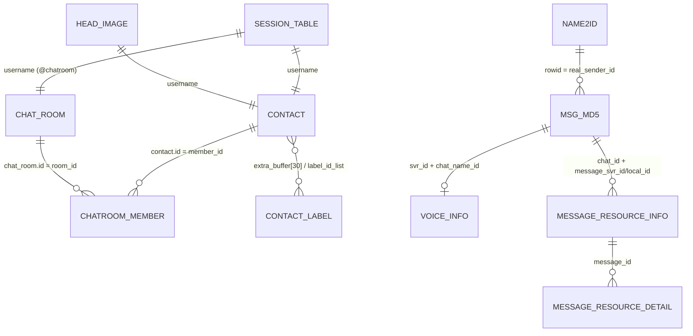

# Windows 微信 4.x 本地数据库详细表结构说明

> 本文档整理自本项目对 Windows 微信 4.x（`Weixin.exe` / `xwechat_files`）本地数据库的实际读取实现（对应源码目录：[Client/Services/WeChat4Db/](../Client/Services/WeChat4Db/)），用于开发维护、字段查阅与排障参考。

---

## 1. 本地存储目录结构

Windows 微信 4.x 将原 3.x 的 `WeChat Files` 升级为 `xwechat_files`，每个登录账号对应一个 `<wxid>_<4位十六进制>` 目录：

```text
<数据根目录>\xwechat_files\
├── all_users\                              # 全局配置目录（非账号目录）
└── <wxid>_<4hex>\                          # 单个微信账号目录
    ├── db_storage\                         # 所有 SQLCipher 4 加密数据库（含 -wal / -shm）
    │   ├── contact\
    │   │   └── contact.db                  # ★ 联系人、陌生人、微信标签、群聊、群成员
    │   ├── session\
    │   │   └── session.db                  # ★ 会话列表、最后消息摘要与时间戳
    │   ├── head_image\
    │   │   └── head_image.db               # ★ 本地头像图片二进制缓存
    │   ├── message\
    │   │   ├── message_0.db ~ message_N.db # ★ 分片聊天消息库（每会话独立 Msg_<md5> 表）
    │   │   ├── message_resource.db         # ★ 消息与本地媒体附件路径/MD5 索引库
    │   │   └── media_0.db ~ media_N.db     # ★ 语音二进制库（SILK v3）
    │   ├── message_fts.db / *_fts.db       # 全文检索库（体积大，同步时跳过）
    │   ├── sns.db / favorite.db / ...      # 朋友圈、收藏、公众号等非核心库（跳过）
    ├── msg\
    │   ├── attach\<md5(session)>\YYYY-MM\Img\
    │   │   ├── <hash>_h.dat                # 高清原图（加密 .dat）
    │   │   ├── <hash>.dat                  # 标准图（可能为 WXGF 或 JPG/PNG）
    │   │   └── <hash>_t.dat                # 缩略图（加密 .dat，常为 JPEG 兜底）
    │   └── video\YYYY-MM\
    │       ├── <hash>.jpg / <hash>_thumb.jpg # 视频封面图（明文 JPEG）
    │       └── <hash>.mp4                  # 视频本体（明文 MP4）
    └── ...
```

### 数据目录自动发现顺序（[WeChat4Paths.cs](../Client/Services/WeChat4Db/WeChat4Paths.cs)）

1. `%APPDATA%\Tencent\xwechat\config\*.ini` 中记录的存储路径（支持 `MyDocument:` 占位符）
2. 注册表 `HKCU\Software\Tencent\Weixin\FileSavePath` / `HKCU\Software\Tencent\WeChat\FileSavePath`
3. 当前用户的「文档」目录（`Explorer\User Shell Folders\Personal`）
4. 本地固定盘符常见根目录快速扫描（`Users`、`Documents`、`WeChat`、`Tencent`、`ProgramData`）

---

## 2. 数据库加密与 WAL 机制

微信 4.x 使用 **SQLCipher 4**（WCDB）对每个 `.db` 文件独立加密，并默认开启 **WAL（Write-Ahead Logging）** 模式：

| 参数项 | 规格说明 |
| :--- | :--- |
| 页大小（`PageSize`） | `4096` 字节（4 KB） |
| 加密算法 | AES-256-CBC（无填充） |
| 密钥派生（KDF） | PBKDF2-HMAC-SHA512，迭代 `256,000` 次，输出 32 字节 `encKey` |
| 校验算法（HMAC） | HMAC-SHA512；`macSalt = page1[0..16] ^ 0x3A`，`macKey = PBKDF2(encKey, macSalt, 2, SHA512, 32)` |
| 每页尾部保留区（`ReserveSize`） | `80` 字节 = `16 B IV`（偏移 `4016..4032`）+ `64 B HMAC`（偏移 `4032..4096`） |
| 第 1 页头部 | 前 `16` 字节为明文 `Salt`（解密后替换为标准头 `"SQLite format 3\0"`） |
| WAL 增量文件（`-wal`） | `32 B` WAL Header（魔数 `0x377F0682` LE / `0x377F0683` BE）+ 若干帧（每帧 `24 B` 帧头 + `4096 B` 加密页） |

> **关键点**：微信运行期间最新收发的消息往往停留在 `*.db-wal` 尚未 checkpoint 回主 `.db` 文件。因此读取时必须同时快照 `.db` + `.db-wal` + `.db-shm`，解密主库后再按页号合并解密 WAL 帧，才能拿到实时消息。实现见 [WeChat4Crypto.cs](../Client/Services/WeChat4Db/WeChat4Crypto.cs) 与 [WeChat4Decryptor.cs](../Client/Services/WeChat4Db/WeChat4Decryptor.cs)。

---

## 3. 核心数据库关联总览



---

## 4. 各数据库详细表结构

### 4.1 `contact/contact.db`（联系人、标签、群聊与群成员）

#### ① `contact` 表 / `stranger` 表（通讯录与陌生人）

`contact` 存放好友、群聊基础档案、公众号及系统账号；`stranger` 存放未加好友的群成员等临时联系人。

| 字段名 | 类型 | 说明 |
| :--- | :--- | :--- |
| `id` | INTEGER | 内部自增行 ID，被 `chatroom_member.member_id` 引用 |
| `username` | TEXT | 全局唯一标识：<br>- 普通好友：`wxid_xxx` 或自定义微信号<br>- 群聊：`xxx@chatroom`<br>- 企业微信好友：`xxx@openim`<br>- 公众号：`gh_xxx`<br>- 系统号：`filehelper`、`weixin`、`fmessage` 等 |
| `alias` | TEXT | 用户设置的微信号（展示用微信号） |
| `nick_name` | TEXT | 微信昵称 |
| `remark` | TEXT | 好友备注名（或群备注名） |
| `description` | TEXT | 好友描述（部分版本存放在 `extra_buffer` 字段 10） |
| `big_head_url` | TEXT | 高清头像 CDN URL（`qpic.cn` / `qlogo.cn`） |
| `small_head_url` | TEXT | 缩略头像 CDN URL |
| `verify_flag` | INTEGER | 认证标志位：`(verify_flag & 8) != 0` 表示公众号/服务号 |
| `local_type` | INTEGER | 联系人本地类型（常见好友为 `0` / `1` / `3` / `5`） |
| `label_id_list` | TEXT | 逗号分隔的标签 ID 列表（旧字段；微信 4.x 实际常写入 `extra_buffer` 字段 30） |
| `extra_buffer` | BLOB | **Protobuf 扩展信息**，包含性别、地区、签名、电话与标签 ID 列表 |

**`contact.extra_buffer` Protobuf 字段映射**（[WeChat4Reader.cs](../Client/Services/WeChat4Db/WeChat4Reader.cs#L1561-L1625)）：

| Protobuf Field | Wire Type | 含义 | 说明 |
| :---: | :---: | :--- | :--- |
| `2` | Varint (`0`) | 性别 | `1` = 男，`2` = 女，其他为空 |
| `4` | Length-delimited (`2`) | 个性签名 | UTF-8 字符串 |
| `5` | Length-delimited (`2`) | 国家 | UTF-8 字符串（如 `CN`，展示时通常忽略 `CN`） |
| `6` | Length-delimited (`2`) | 省份 | UTF-8 字符串 |
| `7` | Length-delimited (`2`) | 城市 | UTF-8 字符串 |
| `10` | Length-delimited (`2`) | 联系人描述 | 当 `description` 列为空时回退读取 |
| `13` / `14` | Length-delimited (`2`) | 手机号/联系电话 | 含数字且长度 ≤ 32 的字符串 |
| `30` | Length-delimited (`2`) | **微信标签 ID 列表** | 微信 4.x 核心位置，逗号分隔（如 `"1,4,7"`），对应 `contact_label.label_id_` |

---

#### ② `contact_label` 表（微信通讯录标签字典）

| 字段名 | 类型 | 说明 |
| :--- | :--- | :--- |
| `label_id_` | INTEGER / TEXT | 标签 ID（兼容别名 `label_id` / `id`） |
| `label_name_` | TEXT | 标签名称（兼容别名 `label_name` / `name`） |

---

#### ③ `chat_room` 表（群聊元数据）

| 字段名 | 类型 | 说明 |
| :--- | :--- | :--- |
| `id` | INTEGER | 内部群 ID，被 `chatroom_member.room_id` 引用 |
| `username` | TEXT | 群聊唯一标识（以 `@chatroom` 结尾） |
| `owner` | TEXT | 群主 `username`（`wxid`） |
| `ext_buffer` | BLOB | **Protobuf 群扩展数据**：内嵌每个群成员在本群的「群昵称」列表 |

**`chat_room.ext_buffer` 内嵌成员群昵称 Protobuf 结构**：
- 外层重复出现 Length-delimited（Wire Type `2`）条目；
- 每条子消息内：`Field 1` = 成员 `username`（wxid），`Field 2` = 成员在该群内的显示昵称（群昵称）。
- 群显示名称优先取 `contact` 表中对应 `@chatroom` 记录的 `remark` → `nick_name`；若未命名群，则拼接前 3 位成员名。

---

#### ④ `chatroom_member` 表（群成员关联表）

| 字段名 | 类型 | 说明 |
| :--- | :--- | :--- |
| `room_id` | INTEGER | 关联 `chat_room.id` |
| `member_id` | INTEGER | 关联 `contact.id`（或 `stranger.id`） |

---

### 4.2 `session/session.db`（会话列表与变更摘要）

#### `SessionTable` 表

| 字段名 | 类型 | 说明 |
| :--- | :--- | :--- |
| `username` | TEXT | 会话对象 `username`（好友 `wxid` 或群聊 `@chatroom`） |
| `summary` | TEXT / BLOB | 最新一条消息预览摘要（可能经 Zstd 压缩，含微信自带表情码如 `[微笑]`） |
| `last_timestamp` | INTEGER | 最后一条消息的 Unix 秒级时间戳 |
| `sort_timestamp` | INTEGER | 会话排序时间戳（置顶/草稿会影响排序，取 `max(sort_timestamp, last_timestamp)` 作为最近活跃时间） |

> **增量优化用法**：自动监听同步时先比对 `SessionTable` 中各会话的 `LastMessageTime`，时间戳未变化的会话直接跳过，不重复扫描 `Msg_<md5>` 表。

---

### 4.3 `message/message_0.db ~ message_N.db`（分片聊天消息库）

当聊天记录体积增长时，微信会按顺序切分多个分片库（`message_0.db`、`message_1.db` ...）。同一个会话的消息表可能同时存在于多个分片库中，读取时需合并所有分片并按 `(create_time, shard, local_id)` 排序。

#### ① `Name2Id` 表（发件人 ID 字典）

| 字段名 | 类型 | 说明 |
| :--- | :--- | :--- |
| `rowid` | INTEGER | 隐式 SQLite 行号，被消息表 `real_sender_id` 引用 |
| `user_name` | TEXT | 发件人 `username`（`wxid` / `@chatroom` / `@openim`） |

#### ② `Msg_<md5(username)>` 表（单会话独立消息表）

表名计算公式：
```text
table_name = "Msg_" + lowercase(MD5(UTF8(session_username)))
```

| 字段名 | 类型 | 说明 |
| :--- | :--- | :--- |
| `local_id` | INTEGER | 本分片内的本地自增消息 ID |
| `server_id` | INTEGER | 微信服务端全局唯一消息 ID（未同步/本地系统消息可能为 `0`） |
| `local_type` | INTEGER (64-bit) | 消息类型编码：<br>- 低 32 位为主类型（如 `1` 文本、`3` 图片、`34` 语音、`49` 应用消息）<br>- 高 32 位在部分应用消息中表示子类型（如 `57` 引用、`6` 文件） |
| `sort_seq` | INTEGER | 会话内精确排序序列号（优先 `ORDER BY sort_seq ASC, local_id ASC`） |
| `real_sender_id` | INTEGER | 实际发送者 ID，对应同库 `Name2Id.rowid`（与当前账号 `SelfWxid` 一致即为「我发出」） |
| `create_time` | INTEGER | 消息发送时间（Unix 秒级时间戳） |
| `message_content` | TEXT / BLOB | 消息主体内容（纯文本、XML，或 **Zstd 压缩字节流**，魔数 `28 B5 2F FD`） |
| `compress_content` | BLOB / TEXT | 压缩存储的消息内容（长文本/XML/应用消息常存放在此列，同样采用 Zstd 压缩） |
| `packed_info_data` | BLOB | **Protobuf 扩展元数据**：<br>- 图片/视频/表情：嵌套存放 16 B 原始 MD5、32 位十六进制 MD5、`.dat`/`.jpg`/`.mp4` 文件名<br>- 语音消息：若微信客户端曾做过语音转文字，会缓存转写文本 |

> **群聊发件人前缀规则**：在群聊（`@chatroom`）的 `message_content` / `compress_content` 解压结果中，非本人消息常以 `<sender_wxid>:\n` 开头；解析时需剥离首行发件人前缀，并在 `real_sender_id` 缺失时用该前缀补全发送人。

---

### 4.4 `message/message_resource.db`（消息-本地媒体索引库）

用于补全部分图片/视频/表情在 `message_content` 与 `packed_info_data` 中缺失的本地文件 MD5 或相对路径。

| 表名 | 关键字段 | 说明 |
| :--- | :--- | :--- |
| `ChatName2Id` | `rowid`, `user_name` | 会话名到内部 `chat_id` 的映射 |
| `MessageResourceInfo` | `message_id`, `chat_id`, `message_svr_id`, `message_local_id`, `packed_info` | 按 `chat_id` + (`message_svr_id` 或 `message_local_id`) 关联到消息资源主记录，`packed_info` 含 Protobuf 媒体提示 |
| `MessageResourceDetail` | `message_id`, `data_index`, `packed_info` | 资源明细表，`data_index` 直接存储相对路径或文件名线索（如 `msg/attach/...` 或哈希文件名） |

---

### 4.5 `message/media_0.db ~ media_N.db`（语音音频库）

#### ① `Name2Id` 表
与消息库相同：`rowid` ↔ `user_name`（映射为 `chat_name_id`）。

#### ② `VoiceInfo` 表

| 字段名 | 类型 | 说明 |
| :--- | :--- | :--- |
| `chat_name_id` | INTEGER | 关联同库 `Name2Id.rowid` |
| `svr_id` | INTEGER | 对应 `Msg_<md5>.server_id` |
| `create_time` | INTEGER | 创建时间（多条命中时按 `create_time DESC` 取最新） |
| `voice_data` | BLOB | **腾讯 SILK v3 音频流**（头部为 `0x02 + "#!SILK_V3"` 或 `"#!SILK_V3"`） |

> **播放与转码**：本项目使用 `Konata.Codec` 的 `SilkV3Codec.Decoder` 解码为原始 PCM，并手动封装标准的 **44 字节 RIFF/WAVE 头**（24 kHz、16-bit、单声道 PCM WAV），保证 WinUI 3 `MediaPlayer` 与语音转文字接口均可直接读取。

---

### 4.6 `head_image/head_image.db`（本地头像缓存库）

- 包含以 `username`（或兼容列名 `user_name` / `usrname` / `wxid`）为主键的缓存表，以及存放原始图片二进制（JPEG / PNG / GIF / WebP）的 BLOB 列。
- 本项目头像解析优先级：
  1. 优先读本地 `head_image.db`（离线秒读）；
  2. 未命中时从 `contact.db` 的 `big_head_url` / `small_head_url`（仅限可信腾讯域名 `*.qpic.cn` / `*.qlogo.cn` / `*.weixin.qq.com` / `*.tc.qq.com`）下载；
  3. 群聊若无缓存群头像，则自动取前 9 位群成员头像实时拼接为微信风格九宫格 PNG。

---

## 5. 消息类型字典（`local_type` 与 `appmsg`）

### 5.1 主类型（`local_type` 低 32 位）

| `local_type` | 类型 | XML / 数据关键字段 | 说明 |
| :---: | :--- | :--- | :--- |
| `1` | 文本 | 纯文本 | 普通文字消息（含微信 `[表情]` 码） |
| `3` | 图片 | `` + `packed_info_data` | 本地加密 `.dat` 图片 |
| `34` | 语音 | `<voicemsg voicelength="毫秒" />` | 音频流在 `media_N.db -> VoiceInfo` |
| `37` | 好友请求 | XML | 加好友验证通知 |
| `42` | 名片 | `<msg nickname="..." />` | 个人/公众号名片 |
| `43` / `62` | 视频 / 小视频 | `<videomsg playlength="秒" md5="..." />` | 本地 `msg/video/` 明文封面与 MP4 |
| `47` / `11000` | 动画表情 | `<emoji md5="..." cdnurl="..." desc="..." gametype="..." gameext="..." />` | 表情包；`gametype=1` 为猜拳，`gametype=2` 为骰子 |
| `48` | 位置 | `<location poiname="..." label="..." />` | 地理位置分享 |
| `49` | 应用消息 | `<appmsg><type>子类型</type>...</appmsg>` | 链接、文件、小程序、引用、转发、转账、红包等 |
| `50` | 音视频通话 | XML | 语音/视频通话记录 |
| `51` | 状态同步 | XML | 微信内部已读/设备状态同步（同步时跳过） |
| `66` | 微信连线 | XML | 语音连线 |
| `10000` / `10002` | 系统消息 | `<replacemsg>` / `<content_template>` | 撤回、进群、拍一拍等系统提示 |
| `11001` | 引用消息 | 同 `49 / sub=57` | 微信 4.x 独立引用消息编码 |
| `11002` | 文件消息 | 同 `49 / sub=6` | 微信 4.x 独立文件消息编码 |

### 5.2 应用消息子类型（`local_type = 49` 时的 `<appmsg><type>` 或高 32 位）

| 子类型 | 类别 | 核心 XML 字段 |
| :---: | :--- | :--- |
| `1` | 文本 | `<title>` / `<des>` |
| `5` | 网页链接 | `<title>`、`<des>`、`<url>` |
| `6` | 文件 | `<appattach><filename>`、`<totallen>` |
| `7` / `14` / `19` / `20` | 合并转发聊天记录 | `<title>`、`<recorditem>` 内嵌 `<dataitem>`（`sourcename` / `datadesc`） |
| `8` | 动画表情 | `<title>` |
| `10` / `48` / `62` | 视频号 | `<title>` / `<des>` |
| `11` / `51` / `63` / `88` | 直播 | `<title>` |
| `15` / `17` | 实时位置共享 | `<title>` |
| `24` | 微信笔记 | `<title>` |
| `33` / `36` | 小程序 | `<sourcedisplayname>`、`<title>`、`<url>` |
| `53` | 群接龙 | `<title>` |
| `57` | 引用回复 | `<title>`（回复内容）+ `<refermsg><displayname>` / `<content>` |
| `87` | 群公告 | `<title>` / `<des>` |
| `2000` | 微信转账 | `<wcpayinfo><feedesc>`（金额）、`<pay_memo>`（备注） |
| `2001` / `2003` | 微信红包 | `<title>` / `<des>` |

---

## 6. 本地媒体附件解密与本项目存储策略

### 6.1 加密图片 `.dat`（[WeChat4MediaDecoder.cs](../Client/Services/WeChat4Db/WeChat4MediaDecoder.cs)）

微信 4.x 在 `msg\attach\<md5(session)>\YYYY-MM\Img\` 下存在三代 `.dat` 格式：

| 版本 | 文件头特征 | 解密方式 |
| :--- | :--- | :--- |
| **Legacy** | 无特殊头 | 全文件单字节 XOR（通过 JPEG `FF D8 FF` / PNG `89 50 4E 47` / GIF / WebP 魔数反推 XOR 密钥） |
| **V1** | `07 08 56 31 08 07` | 头部前缀 AES-128-ECB（固定密钥 `MD5("0")[..16]`）+ 中间明文 + 尾部 XOR |
| **V2（4.1+/4.2+）** | `07 08 56 32 08 07` | 头部前缀 AES-128-ECB（账号派生 16 B AES 密钥，从进程内存读取并缓存）+ 中间明文 + 尾部 XOR |

- 同一张图按优先级 `_h.dat`（高清）→ `.dat`（原图）→ `_t.dat`（缩略图）依次尝试；若原图为微信私有 WXGF 格式无法直接渲染，则自动回退到 `_t.dat` 缩略 JPEG。

### 6.2 同步到服务端后的存储优化

| 媒体类型 | 本项目落库/存储策略 |
| :--- | :--- |
| 消息去重键 `external_id` | 有 `server_id` 时为 `wx4:s:<server_id>`；否则为 `wx4:l:<shard>:<local_id>:<create_time>` |
| 聊天图片 | 上传前自动压缩（长边上限 `960px`，JPEG 质量 `0.72`，动图 GIF 与小贴纸保持原样） |
| 视频消息 | **仅保存视频时长标记（如 `🎬 [视频 93"]`）与压缩首帧封面图（`720px`）**，不上传重型 `.mp4` 文件 |
| 语音消息 | 解码为标准 44 B 头 PCM WAV 后存储；右键「语音转文字」的结果以 `🎤 [语音 3"]\n<转写文本>` 永久写回消息正文，支持 FTS5 搜索与 AI 读取 |
| 全文检索 | 服务端 `weixinorc.db` 为客户消息和群消息建立了 SQLite FTS5 `trigram` 虚拟表，支持中文任意子串高速检索 |
